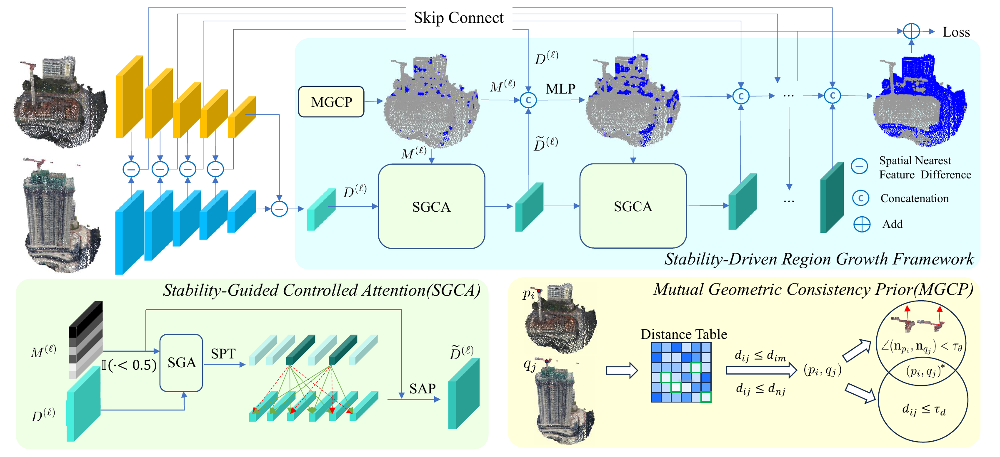

# SRGCD

## Stability-Driven Region Growth Framework for 3D Change Detection

**Yue Wu, Tao Peng, Yongzhe Yuan, Kaiyuan Feng, Hao Li, Maoguo Gong,
Qiguang Miao, and Wenping Ma**

Xidian University and Inner Mongolia Normal University

> **The code and pretrained models will be released soon.**

## Introduction

SRGCD is a stability-driven region growth framework for 3D point cloud change
detection. Instead of treating change detection as one-step point-wise
segmentation, SRGCD starts from reliable unchanged seeds and progressively
propagates stability toward uncertain regions. This coarse-to-fine process
improves spatial consistency, interior completeness, and boundary quality.

<p align="center">
  
</p>

SRGCD achieves **94.11% mIoU** on Urb3DCD-V1 and **78.79% mIoU** on HKCD.

## Citation

```bibtex
@inproceedings{wu2026srgcd,
  title     = {SRGCD: Stability-Driven Region Growth Framework for 3D Change Detection},
  author    = {Wu, Yue and Peng, Tao and Yuan, Yongzhe and Feng, Kaiyuan and
               Li, Hao and Gong, Maoguo and Miao, Qiguang and Ma, Wenping},
  booktitle = {Proceedings of the IEEE/CVF Conference on Computer Vision and
               Pattern Recognition},
  year      = {2026}
}
```
